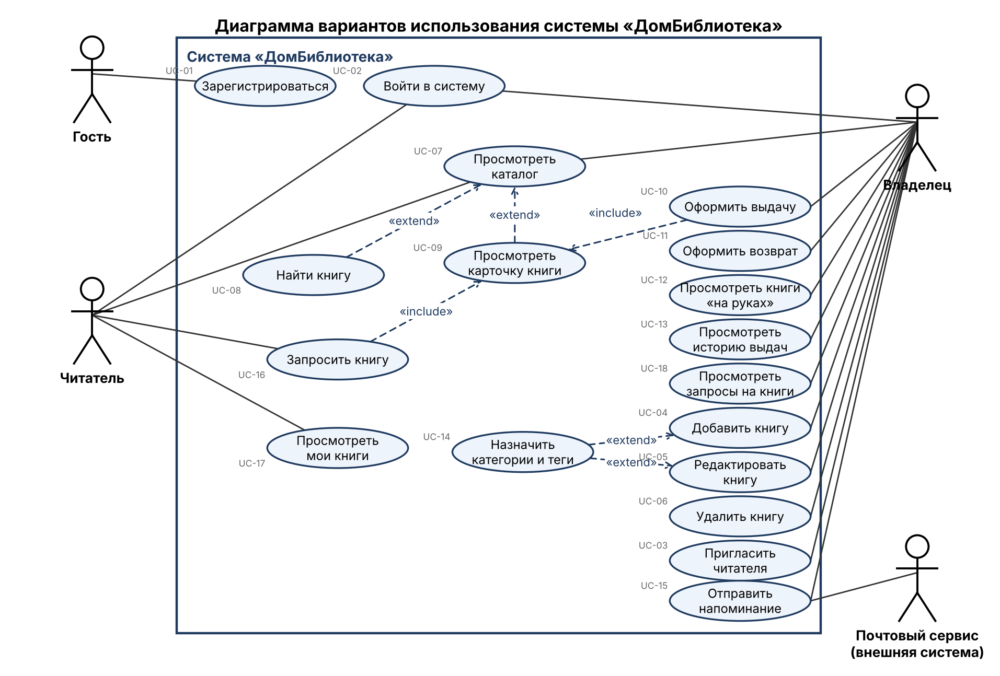

# Варианты использования «ДомБиблиотека»

## Диаграмма

Исходный код диаграммы для PlantUML: [use-case.puml](use-case.puml).

## Акторы

| Актор | Описание |
| --- | --- |
| Гость | Неавторизованный посетитель, может зарегистрироваться |
| Владелец | Хозяин библиотеки: ведёт каталог и оформляет выдачу и возврат |
| Читатель | Приглашённый пользователь: просматривает каталог и запрашивает книги |
| Почтовый сервис | Внешняя система, отправляющая напоминания по электронной почте |

## Список вариантов использования

| ID | Название | Акторы | Требование |
| --- | --- | --- | --- |
| UC-01 | Зарегистрироваться | Гость | FR-01 |
| UC-02 | Войти в систему | Владелец, Читатель | FR-02 |
| UC-03 | Пригласить читателя | Владелец | FR-03 |
| UC-04 | Добавить книгу | Владелец | FR-04 |
| UC-05 | Редактировать книгу | Владелец | FR-05 |
| UC-06 | Удалить книгу | Владелец | FR-06 |
| UC-07 | Просмотреть каталог | Владелец, Читатель | FR-07 |
| UC-08 | Найти книгу (extend UC-07) | Владелец, Читатель | FR-08 |
| UC-09 | Просмотреть карточку книги (extend UC-07) | Владелец, Читатель | FR-09 |
| UC-10 | Оформить выдачу (include UC-09) | Владелец | FR-10 |
| UC-11 | Оформить возврат | Владелец | FR-11 |
| UC-12 | Просмотреть книги «на руках» | Владелец | FR-12 |
| UC-13 | Просмотреть историю выдач | Владелец | FR-13 |
| UC-14 | Назначить категории и теги (extend UC-04, UC-05) | Владелец | FR-14 |
| UC-15 | Отправить напоминание о возврате | Почтовый сервис, Владелец | FR-15 |
| UC-16 | Запросить книгу (include UC-09) | Читатель | FR-16 |
| UC-17 | Просмотреть мои книги | Читатель | FR-17 |
| UC-18 | Просмотреть запросы на книги | Владелец | FR-18 |

## Сценарии использования

### SC-1. Оформление выдачи книги

**Основной актор:** Владелец (UC-10)

**Предусловия:** Владелец авторизован. Книга есть в каталоге и имеет статус «в наличии».

**Основной поток:**

1. Владелец открывает каталог и находит нужную книгу.
2. Владелец открывает карточку книги (UC-09, include) и нажимает «Выдать».
3. Система показывает форму выдачи.
4. Владелец указывает получателя и срок возврата.
5. Система проверяет данные: получатель указан, срок не раньше сегодняшней даты.
6. Система меняет статус книги на «выдана» и создаёт запись в журнале выдач.
7. Система показывает сообщение «Книга выдана» и обновлённую карточку.

**Альтернативные потоки:**

- А1. На шаге 4 не указан получатель или срок возврата раньше даты выдачи: система показывает сообщение об ошибке рядом с полем и остаётся на форме.
- А2. На шаге 2 статус книги «выдана»: кнопка «Выдать» недоступна, система показывает, кому и до какого срока выдана книга.
- А3. На шаге 4 Владелец отменяет операцию: данные не сохраняются, статус не меняется.

**Постусловия:** Книга имеет статус «выдана», запись о выдаче сохранена в истории, книга появилась в списке «на руках».

### SC-2. Запрос книги читателем

**Основной актор:** Читатель (UC-16)

**Предусловия:** Читатель зарегистрирован по приглашению и авторизован. В каталоге есть книга со статусом «в наличии».

**Основной поток:**

1. Читатель открывает каталог (UC-07) и при необходимости ищет книгу по названию или автору (UC-08).
2. Читатель открывает карточку книги (UC-09, include) и нажимает «Запросить».
3. Система показывает поле для необязательного комментария.
4. Читатель вводит комментарий и подтверждает запрос.
5. Система сохраняет запрос с датой и именем читателя.
6. Система показывает сообщение «Запрос отправлен владельцу». Владелец видит запрос в списке запросов (UC-18).

**Альтернативные потоки:**

- А1. Книга имеет статус «выдана»: кнопка «Запросить» недоступна, показывается срок возврата.
- А2. Читатель уже отправил запрос на эту книгу, и он не обработан: новый запрос не создаётся, система сообщает об этом.
- А3. Комментарий длиннее допустимого: система показывает сообщение об ошибке и не сохраняет запрос.

**Постусловия:** Запрос сохранён и доступен Владельцу. Статус книги не изменился.

### SC-3. Оформление возврата книги

**Основной актор:** Владелец (UC-11)

**Предусловия:** Владелец авторизован. Книга имеет статус «выдана» и числится в списке «на руках».

**Основной поток:**

1. Владелец открывает список «на руках» (UC-12).
2. Владелец выбирает книгу, которую вернули, и нажимает «Принять возврат».
3. Система показывает форму с датой возврата (по умолчанию — сегодня) и полем для заметки о состоянии книги.
4. Владелец подтверждает возврат.
5. Система записывает дату возврата и заметку в журнал выдач.
6. Система меняет статус книги на «в наличии» и убирает её из списка «на руках».

**Альтернативные потоки:**

- А1. Срок возврата истёк: система помечает выдачу как возвращённую с опозданием и сохраняет количество дней просрочки в истории.
- А2. Указана дата возврата раньше даты выдачи: система показывает сообщение об ошибке и не сохраняет возврат.
- А3. Книга уже возвращена (другое окно, повторное нажатие): система сообщает, что возврат уже оформлен, и ничего не меняет.

**Постусловия:** Выдача закрыта, статус книги «в наличии», история выдач обновлена.

